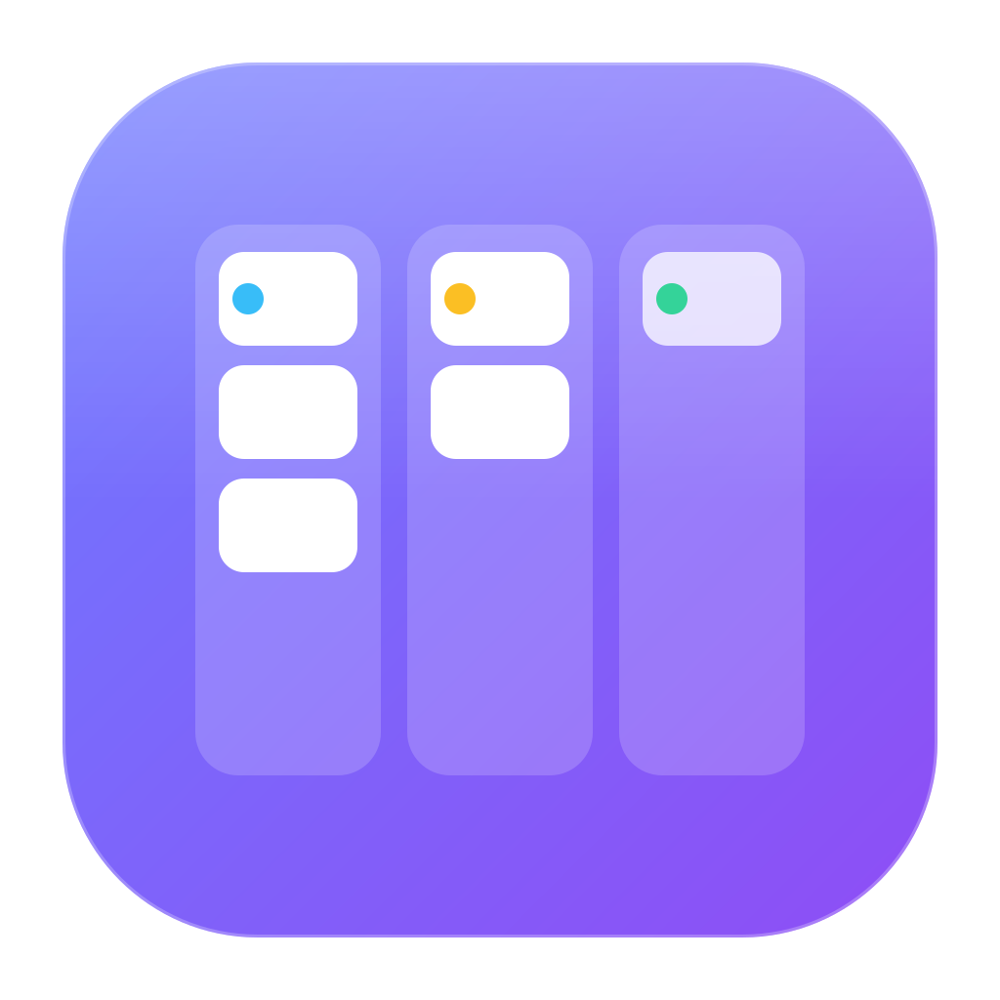

<div align="center">



# LokalBan

**Um Kanban de mesa para Windows, com a estética minimalista do macOS.**
Vidro translúcido, cantos arredondados, sombras suaves — morando direto na sua área de trabalho.

[](LICENSE)
[](https://github.com/Pedrxx/lokalban/actions/workflows/ci.yml)


</div>

---

## Por que existe

A maioria dos gerenciadores de tarefas vive numa aba do navegador que você esquece aberta.
O LokalBan fica **no seu desktop**, atrás das outras janelas, sempre à vista quando você
minimiza tudo — leve (instalador de ~2 MB), offline e sem conta.

É também um projeto de **comunidade**: um lugar para devs de todos os níveis trocarem
experiência real de produto, UX, arquitetura desktop e Rust/React. Se você tem anos de
estrada ou está no primeiro PR, tem espaço para você aqui. Veja o [CONTRIBUTING](CONTRIBUTING.md).

## Funcionalidades

- 🪟 **Widget de desktop** — janela sem moldura, fora da barra de tarefas, fica atrás das outras janelas
- 🧊 **Vidro de verdade** — desfoque Acrylic nativo do Windows sobre o papel de parede, tema claro/escuro automático
- 🚦 **Botões "semáforo"** estilo macOS — esconder, recolher até a barra de título, fixar acima das janelas
- 🗂️ **Kanban completo** — criar, editar, excluir (com desfazer) e arrastar tarefas entre colunas
- 📅 **Histórico por dia** — calendário na barra para ver o quadro de qualquer dia, passado ou futuro, e mover tarefas entre dias; pendentes de dias anteriores passam para hoje (opcional)
- ⚙️ **Colunas configuráveis** — renomear, criar (até 5), escolher a cor (paleta do macOS), reordenar arrastando, marcar como "concluída", fixar em todos os dias ou deixar só num dia
- 📌 **Ícone na bandeja** — mostrar/esconder, iniciar com o Windows, abrir a pasta dos dados, sair
- 💾 **Seus dados num JSON** — `%APPDATA%\com.lokalban.widget\board.json`, com backup automático da versão anterior
- 📍 Lembra posição e tamanho da janela · ⌨️ `Ctrl+N` cria tarefa · uma única instância

## Instalação

Baixe o instalador `LokalBan_x.y.z_x64-setup.exe` na página de
[**Releases**](https://github.com/Pedrxx/lokalban/releases) e execute.

> O instalador ainda não tem assinatura digital, então o Windows SmartScreen pode avisar.
> Clique em **Mais informações → Executar assim mesmo**.

Requisitos: Windows 10/11 (o WebView2 já vem no Windows 11; no 10 o instalador baixa se faltar).

## Desenvolvimento

### Pré-requisitos

| Ferramenta | Versão | Instalação rápida |
|---|---|---|
| Node.js | 20+ (LTS) | `winget install OpenJS.NodeJS.LTS` |
| Rust | stable (MSVC) | `winget install Rustlang.Rustup` |
| VS C++ Build Tools | 2022 | ver [guia do Tauri](https://tauri.app/start/prerequisites/#windows) |

Ou rode o script que verifica e instala o que faltar:

```powershell
powershell -ExecutionPolicy Bypass -File .\scripts\setup-windows.ps1
```

> ⚠️ Não clone dentro de pastas do OneDrive/Dropbox — a sincronização trava arquivos
> do `target/` do Rust e quebra o build. Use algo como `C:\dev\lokalban`.

### Comandos

```bash
npm install            # dependências do frontend
npm run tauri dev      # abre o app com hot reload
npm run dev            # só o frontend no navegador (com papel de parede de preview)
npm run build          # typecheck + build do frontend
npm run format         # Prettier
npm run tauri build    # gera o instalador em src-tauri/target/release/bundle/nsis/
```

> Se a versão instalada estiver aberta, o `tauri dev` só vai trazer ela para frente
> (instância única). Feche pelo ícone da bandeja → **Sair** antes de desenvolver.

### Estrutura

```
src/                     Frontend (React + TypeScript + Tailwind v4)
├─ components/           GlassWindow, TitleBar, TrafficLights, Column, TaskCard, ...
├─ hooks/
│  ├─ useBoard.ts        Estado do quadro: tarefas, colunas, migração de dados
│  └─ useWindowControls  Recolher, fixar no topo, foco da janela
├─ lib/storage.ts        Lê/grava o board.json via comandos Rust (localStorage no navegador)
└─ index.css             Design tokens (vidro, raios, easing)
src-tauri/               Backend (Rust + Tauri 2)
├─ src/lib.rs            Bandeja, esconder-ao-fechar, comandos load_board/save_board
├─ tauri.conf.json       Janela transparente, sem moldura, Acrylic, sempre atrás
└─ capabilities/         Permissões que o frontend pode usar
```

### Decisões de design (e por quê)

- **Acrylic nativo em vez de `backdrop-filter`**: o CSS só desfoca o conteúdo *dentro* da página,
  não o papel de parede. Para vidro real é preciso o efeito do DWM — o custo é que o Windows 11
  recorta os cantos em ~8px (não 16px). O token `--radius-window` em `src/index.css` documenta a troca.
- **Botão amarelo recolhe em vez de minimizar**: sem ícone na barra de tarefas, uma janela
  minimizada não teria como voltar.
- **Botão vermelho esconde**: o app segue vivo na bandeja, como no macOS. "Sair" fica no menu do ícone.
- **Dados em JSON legível**: fácil de fazer backup, versionar ou sincronizar por conta própria.

Discorda de alguma? Ótimo — abra uma [Discussion](https://github.com/Pedrxx/lokalban/discussions).

## Roadmap

Ideias abertas para quem quiser pegar (veja também as issues com `good first issue`):

- [ ] Fixar de verdade no desktop (resistir ao `Win + D`)
- [ ] Prioridade e cor por card
- [ ] Data de entrega com destaque de atraso
- [x] Reordenar colunas arrastando
- [ ] Vários quadros (ex.: "Trabalho", "Pessoal")
- [ ] Atalhos de teclado globais (mostrar/esconder de qualquer lugar)
- [ ] Exportar/importar quadro
- [ ] Assinatura de código do instalador
- [ ] Testes (Vitest para os hooks, `cargo test` para o storage)
- [ ] Internacionalização (en-US)

## Contribuindo

Toda contribuição conta: código, design, revisão de PR, relato de bug, documentação ou só
compartilhar como *você* resolveria um problema. Leia o [guia de contribuição](CONTRIBUTING.md)
e o [código de conduta](CODE_OF_CONDUCT.md).

## Licença

[MIT](LICENSE) © pedrxx e contribuidores do LokalBan.

---

<sub>🇺🇸 **English:** LokalBan is a lightweight, offline desktop Kanban widget for Windows with a macOS-like
glass look, built with Tauri 2, React 19, TypeScript and Tailwind v4. Contributions in English are welcome too.</sub>
